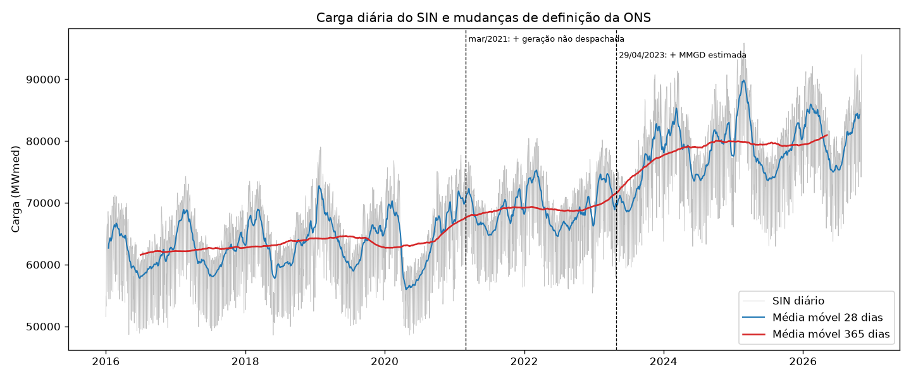

# Auditoria e documentação da base ONS

Referente à issue [#1](https://github.com/CarlSouza02/trabalho-SDM-2026/issues/1). Todos os números abaixo vêm de [`auditoria_carga.py`](../auditoria_carga.py). As tabelas completas estão em [`resultados/auditoria/`](../resultados/auditoria/).

**Resumo**

- A série diária do SIN no período de estudo (2016-01-01 a 2026-11-05) está **completa**: 3.962 dias, sem falhas, sem duplicações e sem valores não positivos.
- O SIN é **exatamente** SE + S + NE + N: a diferença máxima é 0,0 MWmed. A fonte só traz os 4 subsistemas, sem nenhuma linha agregada, então não há dupla contagem.
- Os problemas da fonte (1 registro duplicado e 3 dias sem valor) são **todos anteriores a 2016**.
- As duas mudanças de definição da ONS, em mar/2021 e 29/04/2023, aparecem nos dados como um **salto de cerca de 4 a 6 p.p. no crescimento anual** do SIN. Por isso as séries antes e depois dessas datas não são diretamente comparáveis.
- Os valores extremos são quase todos feriados. Entre os que não são, há um **valor suspeito em 2018-08-25 no NE** (−60% num único dia), que deve ser tratado como possível erro.

---

## 1. Origem

| Item | Valor |
|---|---|
| Conjunto de dados | Carga de Energia Diária (`carga-energia`) |
| Publicador | Operador Nacional do Sistema Elétrico (ONS) |
| Página | <https://dados.ons.org.br/dataset/carga-energia> |
| API usada (CKAN) | <https://dados.ons.org.br/api/3/action/package_show?id=carga-energia> |
| Arquivos | Um Parquet por ano: `CARGA_ENERGIA_<ano>.parquet`, de 2000 a 2026 (também há CSV e XLSX) |
| Endereço dos arquivos | `https://ons-aws-prod-opendata.s3.amazonaws.com/dataset/carga_energia_di/` |
| Dicionário de dados | [PDF](https://ons-aws-prod-opendata.s3.amazonaws.com/dataset/carga_energia_di/DicionarioDados_Carga_Energia_Diaria.pdf) · [JSON](https://ons-aws-prod-opendata.s3.amazonaws.com/dataset/carga_energia_di/DicionarioDados_Carga_Energia_Diaria.json) |
| Atualização pela ONS | Diária, às 12h e às 19h |
| Data de extração | **2026-11-07** (última observação: 2026-11-05) |
| Licença | **Creative Commons Atribuição (CC-BY)**. Permite reutilizar e adaptar os dados, desde que se dê crédito à ONS e se informe o que foi alterado. Os dados são fornecidos "como estão". |
| Contato ONS | relacionamento.agentes@ons.org.br |

**Como citar:** Operador Nacional do Sistema Elétrico (ONS). *Carga de Energia Diária*. Portal de Dados Abertos do ONS. Disponível em <https://dados.ons.org.br/dataset/carga-energia>. Acesso em 7 nov. 2026. Licença CC-BY.

**Alterações feitas por nós** (exigência da CC-BY): consolidação dos arquivos anuais; truncamento do horário para o dia; remoção de 1 registro duplicado; soma dos subsistemas para obter o SIN. Tudo está em [`baixar_carga_ons.py`](../baixar_carga_ons.py).

**Revisões:** a ONS avisa que os dados passam por um processo de consistência recorrente e podem ser alterados depois de publicados. Uma nova extração pode, portanto, mudar valores históricos, principalmente os do ano corrente.

### Reprodução

```bash
python baixar_carga_ons.py     # baixa os Parquet e gera dados/carga_*.parquet
python auditoria_carga.py      # gera resultados/auditoria/
```

## 2. Dicionário de dados

| Coluna | Descrição (ONS) | Tipo após consolidação | Observações |
|---|---|---|---|
| `id_subsistema` | Código do subsistema | texto | `N`, `NE`, `S`, `SE`; `SIN` é criado por nós |
| `nom_subsistema` | Nome do subsistema | texto | Norte, Nordeste, Sul, Sudeste/Centro-Oeste |
| `din_instante` | Data de referência | data (00:00) | Um registro por dia e subsistema |
| `val_cargaenergiamwmed` | Carga de energia, em MWmed | float | Média diária da potência; em 2000–2021 a fonte grava este campo como texto, e convertemos para número |

A unidade é **MWmed**: energia diária (MWh) dividida por 24 h. Somar MWmed entre subsistemas no mesmo dia é válido, porque todos usam a mesma base de tempo.

## 3. Cobertura, duplicações e valores ausentes

Fonte: [`cobertura.csv`](../resultados/auditoria/cobertura.csv) e [`problemas_brutos.csv`](../resultados/auditoria/problemas_brutos.csv).

| Período | Dias esperados | Dias com valor (cada série) | Dias sem valor |
|---|---:|---:|---:|
| Completo (2000-01-01 a 2026-11-05) | 9.806 | 9.803 | 3 |
| **Estudo (2016-01-01 a 2026-11-05)** | **3.962** | **3.962** | **0** |

Problemas encontrados nos arquivos brutos (39.225 registros):

| Data | Subsistema | Problema | Tratamento |
|---|---|---|---|
| 2013-02-02 | S | Registro duplicado com horário `00:00:01` e valor vazio | Removido; fica o registro com valor |
| 2013-12-01 | todos | Valor vazio | NaN em todas as séries (o SIN também fica NaN) |
| 2014-02-01 | todos | Valor vazio | idem |
| 2015-04-09 | todos | Valor vazio | idem |

Não há datas faltando no calendário, valores ≤ 0 nem registros gravados no arquivo de outro ano. Os 3 dias sem valor estão fora do período de estudo. Quem usar o histórico desde 2000 precisa interpolá-los: o `sarima_carga.py` usa interpolação linear.

## 4. SIN = SE + S + NE + N

Fonte: [`checagem_sin.csv`](../resultados/auditoria/checagem_sin.csv).

| Checagem | Resultado |
|---|---|
| Subsistemas presentes na fonte | N, NE, S, SE |
| A fonte tem linha agregada (SIN/total)? | Não |
| Registros por (subsistema, data) após consolidação | No máximo 1 |
| Máx. \|SIN − (SE+S+NE+N)\| | 0,0 MWmed |
| Dias com SIN = NaN | 3 (os mesmos da seção 3) |

**Não há dupla contagem.** Os 4 subsistemas são disjuntos: cada registro pertence a um único subsistema (o Centro-Oeste está dentro de SE). O SIN só vira NaN quando falta algum subsistema; nunca é calculado com soma parcial.

Participação média no SIN em 2016–2026: SE 56,9%, S 17,3%, NE 16,5%, N 9,3%. A participação do N sobe de cerca de 8% para cerca de 12% ao longo do período ([gráfico](../resultados/auditoria/participacao_subsistemas.png)).

## 5. Mudanças de definição da carga (mar/2021 e abr/2023)

O que diz a nota da ONS no portal:

| Período | O que a carga inclui |
|---|---|
| até fev/2021 | Carga atendida por usinas despachadas e/ou programadas pelo ONS (dados do sistema de supervisão e controle) |
| mar/2021 a abr/2023 | O item acima **+ previsão de geração de usinas não despachadas pelo ONS** |
| desde 29/04/2023 | O item acima **+ valor estimado da micro e minigeração distribuída (MMGD)**, com base em previsão meteorológica |

As revisões **não foram aplicadas ao histórico**. A série tem, portanto, dois degraus artificiais.

### Tamanho dos degraus

Para cada data, comparamos o crescimento da carga contra a mesma janela de 1 ano antes e de 2 anos antes, nos dias anteriores e posteriores à mudança. A diferença entre os dois crescimentos aproxima o degrau, já descontada a sazonalidade anual. Fonte: [`quebras_definicao.csv`](../resultados/auditoria/quebras_definicao.csv).

| Mudança | Janela | Cresc. anual antes → depois | Salto (p.p.) | Cresc. 2 anos antes → depois | Salto (p.p.) |
|---|---|---|---:|---|---:|
| mar/2021 | 28 dias | 2,2% → 7,8% | **+5,6** | 0,8% → 7,2% | **+6,4** |
| mar/2021 | 91 dias | 2,9% → 14,9% | +12,0 ⚠ | 1,0% → 5,9% | +4,9 |
| 29/04/2023 | 28 dias | 0,4% → 5,8% | **+5,5** | 2,4% → 6,3% | **+4,0** |
| 29/04/2023 | 91 dias | 0,5% → 5,6% | +5,0 | 3,5% → 5,9% | +2,4 |

⚠ Em mar/2021, a janela de 91 dias contra 1 ano antes usa como base mar–mai/2020, os meses do início da COVID, e por isso superestima o salto. As comparações contra 2 anos antes (base 2019) evitam esse problema.

Os crescimentos acima são do SIN; os valores por subsistema estão no CSV.

**Leitura:** cada mudança acrescenta algo como **+4% a +6% ao nível** do SIN (a janela de 91 dias de 2023 dá um valor menor, +2,4 p.p. contra 2 anos antes). Em 2023 o degrau é maior no NE (+6 a +10 p.p.), coerente com a maior penetração de MMGD solar na região. Isso explica boa parte do crescimento anual médio do SIN em 2021 (+8,1%), 2023 (+7,1%) e 2024 (+7,1%) ([`contagens_anuais.csv`](../resultados/auditoria/contagens_anuais.csv)).

Estas estimativas são descritivas. Uma janela curta não separa totalmente o efeito da definição de choques de clima e atividade econômica; a estimativa formal fica para o modelo.

### Implicações para a modelagem

1. **Treino 2016–2022 / teste 2023–2024:** o degrau de 29/04/2023 cai **dentro do Teste 1**. Um modelo treinado até 2022 vai subprever o período depois do degrau por motivo de definição, não por falha do modelo.
2. Opções (a decidir na issue [#3](https://github.com/CarlSouza02/trabalho-SDM-2026/issues/3)):
   - variáveis degrau (*dummies*) em 2021-03-01 e 2023-04-29 na equação da média;
   - começar a amostra de treino depois de 2021-03-01 e tratar só o degrau de 2023;
   - deixar o nível dinâmico do GAS absorver o degrau, e relatar o tempo de adaptação como diagnóstico.
3. Reportar sempre o período e a definição vigente junto com as métricas.



## 6. Valores extremos

**Método:** resíduo de log(carga) contra a mediana do mesmo dia da semana em ±3 semanas, padronizado por desvio absoluto mediano (MAD) móvel de 365 dias. Marcamos |z| > 4 e classificamos cada dia como feriado nacional/véspera, ponte, festas de fim de ano ou outro. Fonte: [`extremos.csv`](../resultados/auditoria/extremos.csv).

Extremos de 2016 em diante:

| Série | Feriado/véspera | Ponte | Festas | Outro |
|---|---:|---:|---:|---:|
| SIN | 72 | 6 | 1 | 6 |
| SE | 33 | 2 | 1 | 0 |
| S | 64 | 16 | 3 | 22 |
| NE | 54 | 2 | 0 | 12 |
| N | 33 | 0 | 0 | 1 |

Os feriados são o efeito dominante: nos 72 feriados marcados no SIN, a carga fica de 9% a 27% abaixo do padrão (mediana de 15%). Os maiores efeitos são Ano Novo (mediana de −22%), Natal (−21%) e Sexta-feira Santa (−17%). **É preciso incluir efeitos de feriado no modelo**; sem eles, esses dias vão aparecer como outliers nos diagnósticos (issue [#4](https://github.com/CarlSouza02/trabalho-SDM-2026/issues/4)).

Extremos fora de feriado que se explicam por eventos:

| Data | Série(s) | Desvio | Evento |
|---|---|---:|---|
| 2018-03-21 | NE | −14% | Apagão N/NE |
| 2018-05-25 a 29 | S, SIN | −12% a −20% | Greve dos caminhoneiros |
| 2020-03-13 a 26 | S, NE, SIN | ±10% a 20% | Início da COVID-19 (a referência de ±3 semanas mistura antes e depois do *lockdown*) |
| 2021-03-01 | NE | −11% | Dia da mudança de definição |
| 2023-08-15 | N | −18% | Apagão nacional |

**Suspeito:** em **2018-08-25 (sábado)** o NE marca 3.970 MWmed, contra cerca de 10.000 nos dias vizinhos (−60%, z = −36), e o S também cai 18%. Não encontramos um evento que explique isso. Recomendamos tratar como possível erro da fonte (interpolar ou usar *dummy*) e confirmar com a ONS.

Os demais casos "outro" estão concentrados no S (ondas de calor e frio em dez/2018, jan/2019, jan/2022, abr/2016) e não têm causa identificada. Ficam marcados para o diagnóstico.

## 7. Contagens anuais e estatísticas descritivas

Fonte: [`contagens_anuais.csv`](../resultados/auditoria/contagens_anuais.csv) (todas as séries, 2000–2026) e [`estatisticas_periodo.csv`](../resultados/auditoria/estatisticas_periodo.csv).

SIN, em MWmed:

| Ano | Dias | Média | DP | Mín | Mediana | Máx | CV % | Cresc. % |
|---|---:|---:|---:|---:|---:|---:|---:|---:|
| 2016 | 366 | 61.551 | 5.245 | 48.669 | 61.963 | 71.210 | 8,5 | 0,3 |
| 2017 | 365 | 62.686 | 5.518 | 49.295 | 63.250 | 74.300 | 8,8 | 1,8 |
| 2018 | 365 | 63.256 | 5.572 | 48.586 | 63.359 | 73.837 | 8,8 | 0,9 |
| 2019 | 365 | 64.581 | 5.868 | 50.090 | 64.400 | 79.038 | 9,1 | 2,1 |
| 2020 | 366 | 63.409 | 6.635 | 48.601 | 62.484 | 76.815 | 10,5 | −1,8 |
| 2021 | 365 | 68.525 | 5.035 | 55.810 | 69.052 | 77.752 | 7,3 | 8,1 ¹ |
| 2022 | 365 | 68.797 | 5.551 | 55.382 | 69.231 | 80.438 | 8,1 | 0,4 |
| 2023 | 365 | 73.705 | 6.626 | 56.342 | 73.906 | 90.755 | 9,0 | 7,1 ² |
| 2024 | 366 | 78.943 | 6.258 | 62.935 | 79.339 | 91.360 | 7,9 | 7,1 ² |
| 2025 | 365 | 79.609 | 6.766 | 62.938 | 79.592 | 95.881 | 8,5 | 0,8 |
| 2026 ³ | 309 | 80.887 | 6.361 | 63.742 | 81.403 | 94.005 | 7,9 | — |

¹ Inclui o degrau de mar/2021 e a recuperação após a COVID. ² Inclui o degrau de 29/04/2023 (parcialmente em 2023 e completo na comparação 2024/2023). ³ Até 2026-11-05; ano incompleto e sujeito a revisão.

Período de estudo (2016-01-01 a 2026-11-05), todas as séries:

| Série | Média | DP | Mín | Mediana | Máx | Assimetria | Curtose (excesso) | CV % | DP de Δlog diário % |
|---|---:|---:|---:|---:|---:|---:|---:|---:|---:|
| N | 6.451 | 1.294 | 4.478 | 5.917 | 10.366 | 0,83 | −0,41 | 20,1 | 4,3 |
| NE | 11.435 | 1.511 | 3.970 | 11.193 | 16.470 | 0,44 | −0,36 | 13,2 | 6,0 |
| S | 12.073 | 1.981 | 7.589 | 11.922 | 19.247 | 0,35 | 0,31 | 16,4 | 12,9 |
| SE | 39.513 | 5.070 | 26.770 | 39.436 | 55.585 | 0,21 | −0,23 | 12,8 | 8,0 |
| **SIN** | **69.471** | **9.191** | **48.586** | **68.762** | **95.881** | **0,27** | **−0,40** | **13,2** | **7,9** |

O mínimo do NE (3.970) é o valor suspeito de 2018-08-25. A curtose negativa do nível reflete a tendência e os degraus. A distribuição condicional (resíduos) deve ser avaliada no modelo.

## 8. Limites de comparabilidade temporal (para o relatório)

1. **Definição da carga:** três regimes (até fev/2021; mar/2021 a abr/2023; desde 29/04/2023), com degraus de cerca de +4% a +6% cada. As variações entre esses regimes não são crescimento de consumo.
2. **MMGD estimada:** desde 29/04/2023 parte da carga é **estimada a partir de previsão meteorológica**, e não medida. Isso pode acrescentar ruído ligado ao clima e mudar o padrão intradiário e sazonal (mais carga "visível" em dias ensolarados).
3. **Revisões:** a ONS revisa valores depois de publicá-los. Os resultados valem para a extração de 2026-11-07.
4. **COVID-19 (mar–dez/2020):** carga de abr–mai/2020 de 11% a 13% abaixo do mesmo mês de 2019, seguida de recuperação. Ela afeta qualquer janela de treino que inclua 2020.
5. **Ano corrente incompleto:** 2026 vai até 2026-11-05 e é o ano mais sujeito a revisão.
